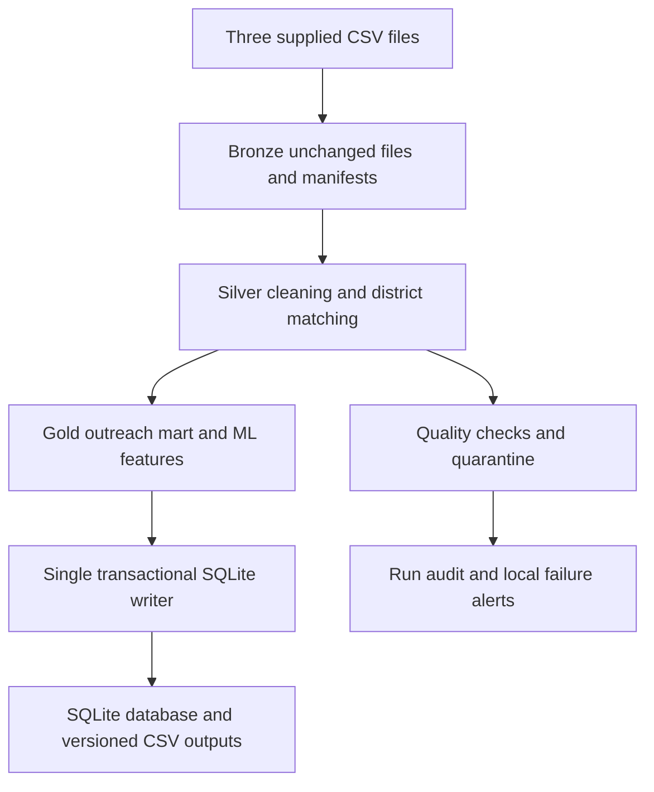

# Jharkhand Mini-UDDP — PySpark and SQLite

The pipeline integrates three supplied aggregate CSV files, filters Jharkhand, validates district records and produces an outreach mart and ML feature table for **24 districts**. Pension counts are supplied **estimates**, preserved unchanged. They are not officially observed district beneficiary counts.

## Important files

- `PROJECT_ANALYSIS_AND_FUTURE_IMPROVEMENTS.md`: findings, engineering decisions, actual issues and roadmap.
- `docs/verification.md`: actual test/run evidence and execution limits.
- `docs/schema_documentation.md` and `sql/schema.sql`: complete column definitions and constraints.
- `docs/source_column_profile.csv`: every original source column, inferred type, blanks and sample.
- `outputs/mart_district_pension_outreach.csv`: TARGET FILE
- `outputs/ml_district_features.csv`: TARGET FILE
- `outputs/district_match_report.csv`: TARGET FILE

## Verified working setup

| Component | Working version |
|---|---|
| Operating system | Windows 11 |
| Terminal | VS Code PowerShell |
| Python | 3.11.9, 64 bit |
| Virtual environment | `.venv311` |
| Java | Temurin JDK 17.0.20.1 |
| PySpark | 3.5.6 |
| SQLite | Included with Python; version 3.37 or newer required |

**Use Python 3.11 for this Windows setup.** Python 3.12 started Spark but crashed when Python workers executed. The same worker test passed with Python 3.11, followed by a successful full pipeline run. The earlier Linux verification used Python 3.12; that does not establish Windows compatibility.

## Quick start when dependencies are already installed

Open your existing GitHub project folder in VS Code. Select **Terminal → New Terminal → PowerShell**. Run the following commands in that terminal.

### 1 Open the project directory

```powershell
cd "C:\Users\pc\mini UDDP pipeline\jharkhand-mini-uddp"
```

Replace this path if your checkout lives elsewhere. Run `dir` and confirm that `src`, `config`, `data`, `scripts` and `requirements-dev.txt` are present.

### 2 Configure Java and Python for this terminal

```powershell
$env:JAVA_HOME = 'C:\Program Files\Eclipse Adoptium\jdk-17.0.20.101-hotspot'
$venvScripts = (Resolve-Path .\.venv311\Scripts).Path
$env:PATH = "$venvScripts;$env:JAVA_HOME\bin;$env:PATH"
$env:PYSPARK_PYTHON = 'python.exe'
$env:PYSPARK_DRIVER_PYTHON = 'python.exe'
$env:SPARK_LOCAL_IP = '127.0.0.1'
```

The Java path above matches the successful user setup. On another machine, replace it with the actual JDK 17 folder containing `bin\java.exe`.

Putting the virtual environment first on PATH lets Spark call `python.exe` without passing the full executable path containing spaces. Your existing GitHub folder can stay in its current location.

These settings last for the current terminal only. Repeat this configuration after opening a new terminal; do not reinstall dependencies each time.

### 3 Check the selected programs

```powershell
java -version
python.exe -c "import sys; print(sys.version); print(sys.executable)"
```

Expected: Java 17, Python 3.11.9 and an executable ending in `.venv311\Scripts\python.exe`.

### 4 Run the pipeline

```powershell
.\.venv311\Scripts\python.exe -m src.main --work-dir runtime
```

Wait for PowerShell to return to its prompt. Spark displays progress and logs during execution. A successful run ends with a JSON summary containing:

```json
{"status": "SUCCEEDED"}
```

This is only an excerpt; the actual summary also includes the run ID, output path and hashes. A traceback or `Pipeline failed` message means the run needs investigation.

### 5 Open your generated results

```powershell
$run = Get-Content .\runtime\outputs\latest_success.json -Raw | ConvertFrom-Json
$runFolder = Join-Path (Resolve-Path .\runtime).Path $run.output_path
explorer.exe $runFolder
```

The latest-success file identifies the published run. Do not choose a folder merely because it is newest: failed attempts also retain diagnostic folders.

| File in the successful run folder | What it contains |
|---|---|
| `mart_district_pension_outreach.csv` | 24 district records, pension estimates, rates, score and category |
| `ml_district_features.csv` | 24 district feature records and rule-derived target |
| `data_quality_report.csv` | Expected and actual values, status, severity and resolution |
| `data_quality_report.md` | Readable quality summary |
| `district_match_report.csv` | Matching status for each source and district |
| `row_reconciliation.csv` | Accounting for source, excluded, accepted and rejected rows |
| `rejected_records.csv` | Rejected records and reasons; header-only for the clean baseline |
| `score_sensitivity.csv` | Alternative weights and their effect on district ranks |
| `silver` folder | Cleaned tables exported as CSV |
| `publication.json` | Run identity, source/config/code fingerprints and CSV hashes |

Open CSV files in Excel or VS Code. The database is `runtime\uddp.sqlite`.

```powershell
.\.venv311\Scripts\python.exe -m src.inspect_db runtime\uddp.sqlite
```

The packaged `outputs` directory contains the delivered sample. Your new runs publish under `runtime`; they do not replace that sample directory.

## First time installation

Skip this section if `.venv311` is installed and the pipeline already works.

1. Install the **Windows 64-bit Python 3.11.9 installer** from [Python](https://www.python.org/downloads/release/python-3119/).
2. Install **JDK 17** from a trusted vendor such as [Eclipse Temurin](https://adoptium.net/temurin/releases/?version=17).
3. Open the project folder in VS Code and start a PowerShell terminal.
4. Check Python, create a new virtual environment and install the pinned packages:

```powershell
py -3.11 --version
py -3.11 -m venv .venv311
.\.venv311\Scripts\python.exe -m pip install --upgrade pip setuptools wheel
.\.venv311\Scripts\python.exe -m pip install -r requirements-dev.txt
```

Wait for each command to finish before running the next. A virtual environment is a private collection of Python packages for this project. Explicit interpreter paths mean activation is unnecessary.

The development requirements include PySpark 3.5.6, py4j 0.10.9.7, pytest 8.3.5, NumPy 1.26.4, pandas 2.2.3 and PyArrow 17.0.0. pandas and PyArrow support Spark's testing utilities; business transformations use Spark DataFrames and SQL.

SQLite is bundled with Python. No separate database server, JDBC driver, Spark cluster or cloud account is required. `requirements-docs.txt` is only needed to regenerate report diagrams.

In VS Code, press **Ctrl+Shift+P → Python: Select Interpreter → Enter interpreter path** and select the `.venv311\Scripts\python.exe` in this project. Terminal environment configuration is still required for Java and Spark.

Continue with the Quick start configuration above.

## Environment and worker checks

Run the environment check:

```powershell
.\.venv311\Scripts\python.exe scripts\verify_environment.py
```

Expected final message: `Spark action: PASS; 24 rows`.

That check exercises a Spark action but does not prove Python workers work. To verify Python worker execution, paste this entire PowerShell block:

```powershell
@'
import sys
from pyspark.sql import SparkSession

print("Python:", sys.version)
print("Executable:", sys.executable)
spark = SparkSession.builder.master("local[1]").appName("WorkerCheck").getOrCreate()
try:
    result = spark.sparkContext.parallelize([1, 2, 3], 1).map(lambda x: x + 1).collect()
    print("WORKER TEST PASSED:", result)
finally:
    spark.stop()
'@ | .\.venv311\Scripts\python.exe -
```

Expected: `WORKER TEST PASSED: [2, 3, 4]`.

## Inputs and architecture

Keep the three supplied source files unchanged in `data/input`. The shipped configuration expects:

- `india-districts-census-2011(3).csv`
- `District-level households and housing indicators(3).csv`
- `Jharkhand_District_Estimated_Pension_Beneficiaries_Updated(3).csv`

Actual filenames must match `config/settings.json`. Do not rename a file without updating its declared filename.



Bronze preserves source evidence. Silver standardizes names, district codes and types. Gold creates district metrics and an explainable score. Data must pass the quality gates before a successful snapshot is published.

### Main database tables

| Table | Grain |
|---|---|
| `dim_district` | One row per district |
| `fact_district_demographics` | District and latest source snapshot |
| `fact_district_housing` | District and latest source snapshot |
| `fact_pension_beneficiaries` | District and scheme, supplied estimate |
| `pension_state_rollup` | State and scheme, sum of district estimates |
| `mart_district_pension_outreach` | One row per district |
| `ml_district_features` | One row per district |

Supporting tables retain source manifests, mappings, rejected records, quality results and execution history. SQLite receives bounded results through one Python driver connection and parameterized transactions. No Spark executors write SQLite concurrently.

## Interpret results correctly

- Old-age pension estimates sum to **993,567**; widow estimates to **272,108**; disability estimates to **31,286**.
- All 72 supplied district/scheme values are preserved; the pipeline does not generate fresh allocations.
- Rates per 1,000 residents are population-normalized estimated entries, not coverage among eligible persons.
- Census indicators are historical. Pension reference year and allocation methodology are not supplied.
- Housing `Total Number of households` equals 100 in the Jharkhand input and is treated as a percentage base. Census `Households` provides the absolute household count, with its universe limitation documented.
- Elderly share and eligibility-based coverage remain NULL because verified denominators are absent.
- The score weights are 35% dilapidated housing, 25% open sanitation, 20% low crude literacy, 10% low estimated old-age rate and 10% low estimated widow rate, using min-max normalization.
- Score descending and district code ascending create deterministic ranks: **8 High, 8 Medium and 8 Low** districts. Godda ranks first at **84.58835663** for these inputs.
- `high_priority` is derived from the same rule. It is not an independent outcome label proving predictive performance.

## Run automated tests

```powershell
.\.venv311\Scripts\python.exe -m pytest -q
```

To retain a log and stop at the first failure:

```powershell
.\.venv311\Scripts\python.exe -m pytest -x -vv -s *> pytest_first_failure.log
```

Open the captured log:

```powershell
code .\pytest_first_failure.log
```

For an isolated rerun/idempotency check:

```powershell
.\.venv311\Scripts\python.exe -m pytest tests/test_pipeline.py::test_end_to_end_and_idempotency -x -vv -s *> pytest_idempotency.log
```

Tests use temporary working directories. Keep the full earliest error: later `ConnectionRefusedError` messages may cascade after the Java process becomes unavailable.

### Honest verification status

| Check | Evidence |
|---|---|
| Original Linux test suite | 55 passed in the delivered revision |
| Windows Python worker check | Passed on Python 3.11.9 |
| Windows full pipeline | SUCCEEDED on 31 October 2026, with 24 districts |
| Cross-platform Gold and ML outputs | Windows hashes matched delivered verified hashes |
| Windows full pytest suite | Not yet passing; uploaded run reported 30 failed, 16 passed and 10 errors |
| Windows test investigation | First-failure capture required; original cause not established |

The successful Windows run ID was `13cb0024773d4e7ebbb4b387ab1c246d`. Gold SHA-256 was `34d2096f53e81943cebfec2fee95ca27f3896a6e019dc3f39ee3a0ecff2a0e54`; ML SHA-256 was `3e3450ca292859d07e0e8e9c6ea743a989ae6b9458198665c46455a65f092d88`.

The expected clean-baseline quality report has 37 PASS, 4 WARN and 0 FAIL. Inspect your actual run report to confirm. Warnings disclose source limitations; they do not replace the separate automated test results.

## Reruns and backfill

Run the same pipeline command again to refresh the database snapshot. Primary keys and transactional loading prevent duplicate business rows. Run IDs, timestamps and audit records change; deterministic analytical CSV hashes should stay the same for unchanged inputs/configuration/code.

Use a specific logical date when needed:

```powershell
.\.venv311\Scripts\python.exe -m src.main --work-dir runtime --logical-date 2026-10-31
```

Backfill example:

```powershell
.\.venv311\Scripts\python.exe -m src.main --work-dir runtime --backfill-start 2026-10-29 --backfill-end 2026-10-31
```

Backfill accepts at most 32 dates. It replays the supplied snapshots; it does not manufacture historical observations. A logical date is a run label, not the dataset's reference year.

## Troubleshooting

| Symptom | Next step |
|---|---|
| `java -version` fails | Test `& "$env:JAVA_HOME\bin\java.exe" -version`; verify the JDK 17 path |
| Java 27 or `getSubject is not supported` | Set JAVA_HOME/PATH to JDK 17 in the current terminal |
| Python worker crash with Python 3.12 on Windows | Use the `.venv311` environment and repeat the worker test |
| `'UDDP' is not recognized` | Repeat the Quick start PATH and Python settings; verify `python.exe` resolves to `.venv311` |
| `No module named pyspark` or `pytest` | Use the `.venv311` executable and install `requirements-dev.txt` |
| Missing PyArrow during pytest collection | Install the development requirements |
| `winutils.exe` or native Hadoop warning | These warnings occurred during the successful run; investigate if followed by a real failure. Do not install arbitrary executable downloads |
| Many `WinError 10061` test errors | Capture the first failing test; do not assume dozens of independent data defects |
| Pipeline lock already exists | Confirm no run is active; follow `docs/deployment_guide.md` for stale-lock recovery |
| Data-quality failure | Inspect the failed run report and rejects; never alter estimate counts simply to meet totals |

A process-termination message after a successful summary can be Spark cleanup. It does not override a preceding failure or establish success by itself. Check the pipeline summary and authoritative database run audit.

## Keep virtual environments out of GitHub

Add these lines to your existing `.gitignore` if absent:

```gitignore
.venv/
.venv311/
.venv312/
__pycache__/
.pytest_cache/
*.log
.env
```

This does not remove files already tracked by Git. Check `git status` before committing. Commit source, requirements and documentation rather than installed environments. Keep credentials and real citizen data out of the repository.

## Automated interactive Excel dashboard

Install the updated dependencies using `.\.venv311\Scripts\python.exe -m pip install -r requirements-dev.txt`. The main pipeline now creates **Jharkhand_UDDP_Interactive_Dashboard.xlsx** automatically from its mart, ML and matching CSVs.

New runs: `runtime/outputs/dashboard/Jharkhand_UDDP_Interactive_Dashboard.xlsx`. Packaged verified sample: `outputs/dashboard/Jharkhand_UDDP_Interactive_Dashboard.xlsx`.

Regenerate Excel alone without rerunning Spark:

```powershell
.\.venv311\Scripts\python.exe -m src.excel_dashboard --work-dir runtime
```

Use the Executive Dashboard for KPIs, High districts and six charts. The mart and ML Excel Tables support sorting/filtering and full-row red/yellow/green priorities. District Matching Report contains original matching records and a district/source matrix. District Comparison has two dropdowns. Dashboard Guide documents interpretation and refresh. Close the XLSX in Excel before regeneration. Open it in Excel to calculate formulas; no Excel installation is required to generate it.

Scores and categories remain those from the existing pipeline. Counts remain supplied estimates; total scheme entries may overlap across people. The High list and chart ranking refresh when regenerated, while comparison dropdown formulas update inside Excel.

See [the dashboard implementation guide](docs/excel_dashboard.md) for failure recovery, exact source mappings, tests and limits. A real rendered preview is included under `docs/dashboard_preview.png` when available. The new revision's test evidence is `outputs/pytest_dashboard_revision.xml`; it supersedes neither the earlier Linux run nor the unresolved user Windows test run.

## Suggested demonstration

1. Explain the three sources and their limitations.
2. Show the worker test passing with Python 3.11 and JDK 17.
3. Run the pipeline and show SUCCEEDED with 24 districts.
4. Open the quality report, Gold mart and ML features.
5. Explain pension total reconciliation and Godda's score.
6. Show automated test evidence, distinguishing the passed Linux suite from the unresolved Windows test run.

Read `ASSUMPTIONS.md` for metric limitations.

For scheduling later, Windows Task Scheduler can invoke the same CLI through a PowerShell wrapper that sets these environment variables and the project working directory. Establish a passing manual run first and allow only one scheduled instance at a time.

Technical references: [Spark 3.5.6](https://spark.apache.org/docs/3.5.6/), [Apache issue SPARK-53759](https://issues.apache.org/jira/browse/SPARK-53759), [Python 3.11.9](https://www.python.org/downloads/release/python-3119/).

