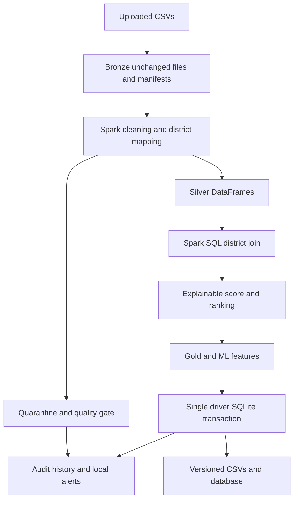

# Jharkhand Mini-UDDP — PySpark and SQLite

A locally reproducible batch pipeline integrates the **three supplied CSV snapshots** for 24 Jharkhand Census districts. Spark performs cleaning, joins, feature engineering and explainable outreach ranking. A single Python driver writes validated district outputs to SQLite in one transaction.

## Important files

- `PROJECT_ANALYSIS_AND_FUTURE_IMPROVEMENTS.md`: findings, engineering decisions, actual issues and roadmap.
- `docs/verification.md`: actual test/run evidence and execution limits.
- `docs/schema_documentation.md` and `sql/schema.sql`: complete column definitions and constraints.
- `docs/source_column_profile.csv`: every original source column, inferred type, blanks and sample.
- `outputs/mart_district_pension_outreach.csv`: TARGET FILE
- `outputs/ml_district_features.csv`: TARGET FILE
- `outputs/district_match_report.csv`: TARGET FILE

## Quick setup on Windows PowerShell

Use 64-bit **Python 3.12** (for example Windows installer 3.12.10), **JDK 17**, and a fresh virtual environment. The verification environment used Python 3.12.14 / OpenJDK 17.0.20. PySpark is pinned to 3.5.6 and py4j to 0.10.9.7. SQLite comes with Python; version 3.37+ is required for STRICT tables.

```powershell
cd C:\projects\jharkhand-mini-uddp
py -3.12 -m venv .venv
.\.venv\Scripts\python.exe -m pip install -r requirements-dev.txt
# Point this to your installed JDK directory, not its bin directory:
$env:JAVA_HOME = 'C:\Program Files\Java\jdk-17'
$env:PATH = "$env:JAVA_HOME\bin;$env:PATH"
$env:PYSPARK_PYTHON = (Resolve-Path .\.venv\Scripts\python.exe).Path
$env:SPARK_LOCAL_IP = '127.0.0.1'
.\.venv\Scripts\python.exe scripts\verify_environment.py
.\.venv\Scripts\python.exe -m src.main --work-dir runtime --logical-date 2026-10-30
.\.venv\Scripts\python.exe -m src.inspect_db runtime\uddp.sqlite
.\.venv\Scripts\python.exe -m pytest -q
```

Virtual-environment activation is optional; explicit interpreter paths avoid PowerShell activation-policy problems. Use your actual JDK path. `requirements.txt` is sufficient for the pipeline; `requirements-dev.txt` also installs pandas/NumPy/PyArrow because Spark's test-helper import requires them. Transformations do not use pandas. `requirements-docs.txt` is only for regenerating figures and Word documentation.

Linux/macOS:

```bash
python3.12 -m venv .venv
.venv/bin/python -m pip install -r requirements-dev.txt
export PYSPARK_PYTHON="$PWD/.venv/bin/python"
export SPARK_LOCAL_IP=127.0.0.1
.venv/bin/python scripts/verify_environment.py
.venv/bin/python -m src.main --work-dir runtime --logical-date 2026-10-30
.venv/bin/python -m pytest -q
```

For Windows Hadoop native-library errors, see `docs/deployment_guide.md`. Do not download unsigned arbitrary `winutils.exe` binaries. WSL2 is a practical local Linux alternative.

## Inputs and grain

| Input in `data/input` | Raw rows | Jharkhand rows | Meaning |
|---|---:|---:|---|
| `india-districts-census-2011(3).csv` | 640 | 24 | Census district demographics |
| `District-level households and housing indicators(3).csv` | 640 | 24 | District housing percentages, Total geography |
| `Jharkhand_District_Estimated_Pension_Beneficiaries_Updated(3).csv` | 24 | 24 | Supplied estimated district pension counts |


The housing total is 100 in every Jharkhand row, so it is not used as a household count. `demographics.Households` supplies the count. The distinct source household universes have not been independently verified. `Literate/Population` is a crude literacy share, not the official age-seven-plus literacy rate. Elderly 60+ and eligible-widow denominators are absent.

## Architecture



The driver copies raw bytes and records SHA-256, source filename, ingestion time and record count. Spark rereads Bronze as strings, then converts selected fields safely. Exact duplicates retain the earliest logical CSV record and report later copies. Conflicting duplicates are all quarantined and block publication. Inner joins build Gold only after left/anti joins have checked complete geographic coverage.

Validated output is bounded to at most 1,000 rows per collected table. This is an explicit small-output contract. The database uses one connection, parameterized `executemany`, batches of 100, PK/FK/CHECK constraints and `BEGIN IMMEDIATE`. Stable Silver facts use UPSERT. Derived Gold/ML rows are refreshed transactionally to avoid temporary collisions when unique ranks swap. No Spark executors or JDBC driver write SQLite.

## Database tables

| Table | Grain | Expected baseline rows |
|---|---|---:|
| dim_district | Census district | 24 |
| fact_district_demographics | District, latest source snapshot | 24 |
| fact_district_housing | District, latest source snapshot | 24 |
| fact_pension_beneficiaries | District and pension scheme, supplied estimate | 72 |
| pension_state_rollup | State and scheme, sum of district estimates | 3 |
| mart_district_pension_outreach | District | 24 |
| ml_district_features | District | 24 |
| district_name_mapping | Source and district | 72 |
| etl_run_log | Execution attempt | Grows |
| source_ingestion_manifest | Run and source | Three per ingested run |
| rejected_records | Run, source and logical CSV record | Zero for supplied clean baseline |
| data_quality_results | Run and check | Grows |

The original assessment's state/scheme pension grain is revised with authorization from the new brief. `pension_state_rollup` retains that summary grain but is explicitly derived from estimates, not independently observed. Latest-snapshot business tables do not preserve multiple observation years; schema changes would be required for genuine historical facts.


## AI-ready features

The feature table contains household-size, female/crude-literacy/work/SC/ST shares, estimated pension rates, housing shares, estimate indicator, score and category. Unsupported eligibility measures remain NULL. `high_priority=1` exactly when category is High. Score, rank/category and their deterministic inputs must not be presented as proof of independently predictive ML. With only 24 rows and a rule-derived target, no model is trained. A future task needs independently measured outcomes, time-aligned features and train-only preprocessing.

## Quality and reconciliation

Raw rows equal out-of-scope plus accepted source rows plus quarantined rows. Pension reshaping converts 24 accepted source rows into 72 district/scheme facts. Totals must equal the supplied controls exactly: 993,567 old age; 272,108 widow; 31,286 disability. Discrepancies fail without rescaling.

Checks cover identifiers, duplicate keys/names, numeric parsing and domains, household/population consistency, source/code matches, anti joins, join cardinality, required fields, score range, target/formula checks, freshness, foreign keys and publication. Reports provide expected/actual values, PASS/WARN/FAIL, severity, affected records and resolution. Four baseline warnings disclose source limitations rather than fabricated quality failures.

## Run outputs and operations

`runtime/outputs/latest_success.json` points to an immutable run folder relative to `runtime`. It contains Gold and ML CSVs, Silver exports, quality reports in CSV/JSON/Markdown, matching/reconciliation/quarantine files, sensitivity scenarios, settings snapshots and hash evidence. The packaged `outputs/` contains a verified sample; new runs publish under `runtime/`.

Reruns preserve business rows and deterministic analytical CSV hashes; run IDs, timestamps and audits change. An exclusive lock prevents concurrent runners. Retry applies only to transient ingestion I/O errors, not missing files or invalid data. Failed attempts retain audits and a local JSON alert hook. No external notification is sent.

Before commit, any error rolls back business changes. A post-commit pointer error leaves the committed run authoritative; recover the output path from `etl_run_log`. Never read a candidate run folder merely because it exists. Never delete an active writer's lock.

```bash
python -m src.main --work-dir runtime --backfill-start 2026-10-28 --backfill-end 2026-10-30
```

Backfill replays at most 32 logical dates over the supplied snapshots. It does not create missing historical observations. Configuration is JSON, with explicit CLI/environment path overrides. `.env.example` is documentation; no dotenv loader is hidden in the code.

## Verification and extension

```bash
python scripts/verify_sample.py
python -m src.profile_sources
python -m src.inspect_db runtime/uddp.sqlite
python -m pytest -q --junitxml=outputs/pytest_results.xml
```

See `docs/verification.md` for actual execution results. PostgreSQL/warehouse migration should replace the small driver boundary with partitioned staging and a controlled merge. For 23 departments, use versioned data contracts, source adapters, geographic/time dimensions, lineage and departmental SLAs before adding infrastructure. Only public aggregates are included; future personal-data integration requires authorized access, separate identity controls, minimization, encryption and audit trails.

Technical compatibility references: [Spark 3.5.6 overview](https://spark.apache.org/docs/3.5.6/), [Spark configuration](https://spark.apache.org/docs/3.5.6/configuration.html), [SQLite UPSERT](https://www.sqlite.org/lang_upsert.html), [SQLite transactions](https://www.sqlite.org/lang_transaction.html).
