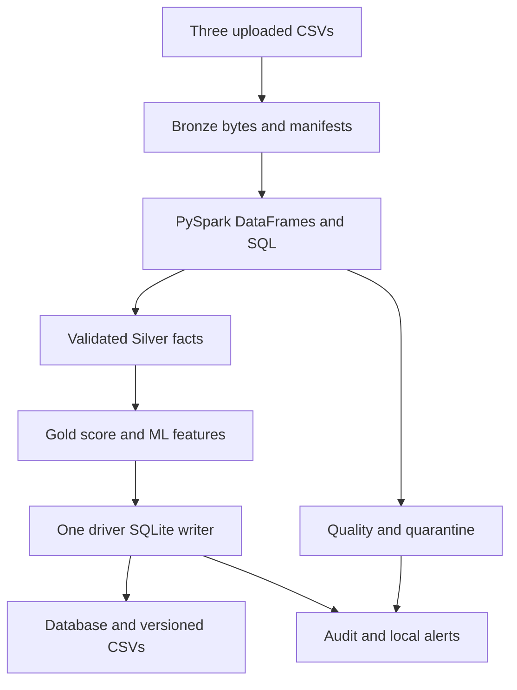
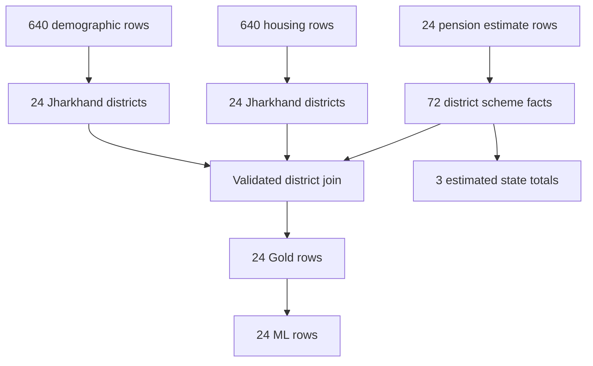
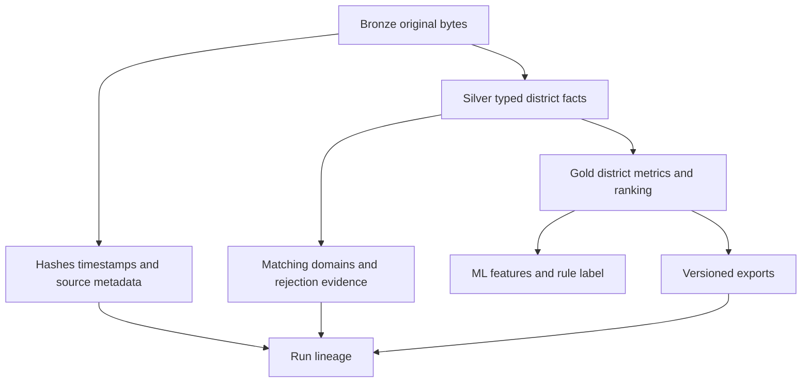
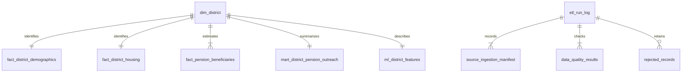
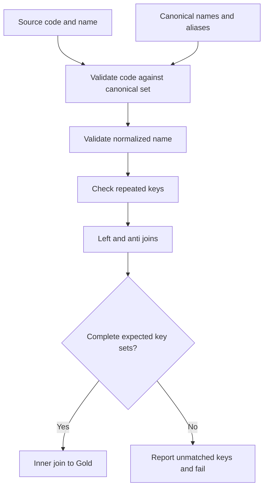
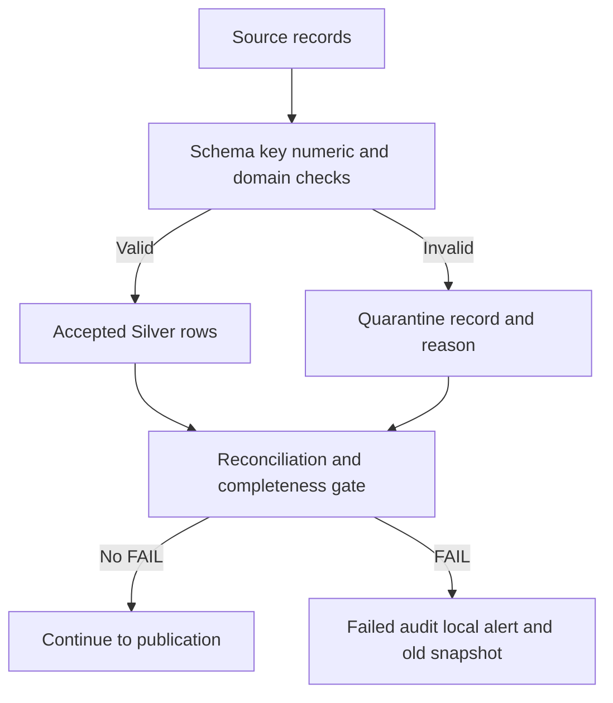
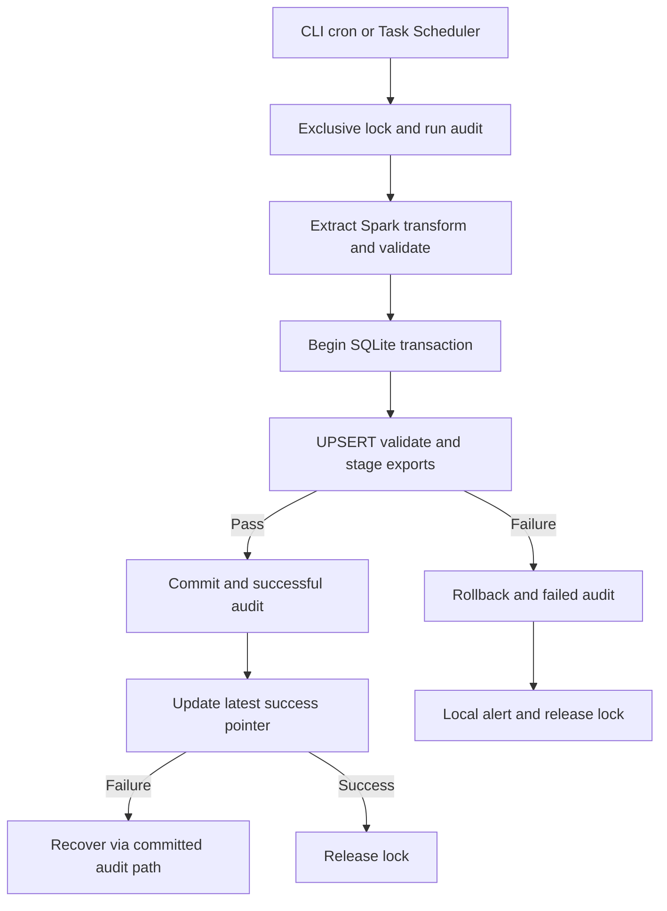
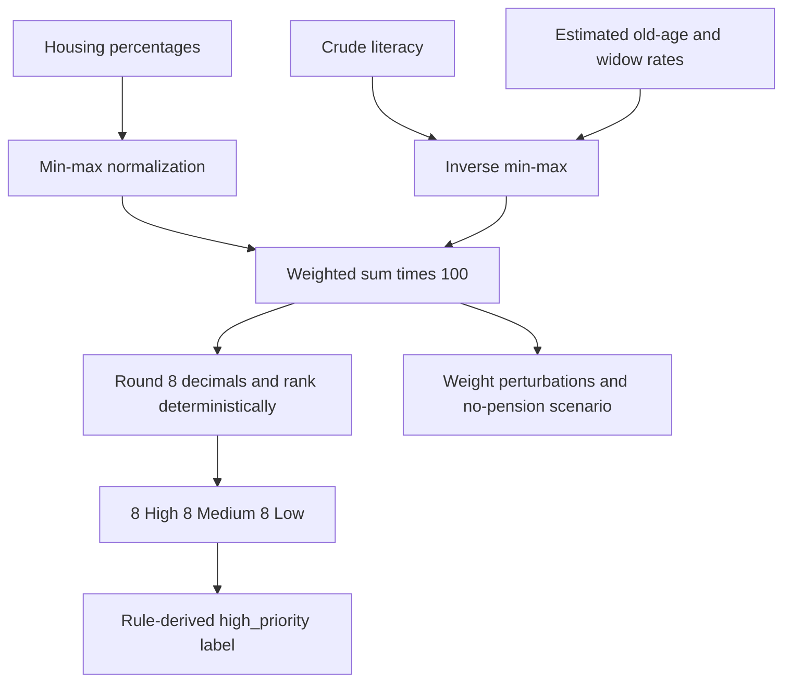

# Architecture and diagram sources

These Mermaid sources accompany the embedded PNGs in the Word report. `scripts/build_report.py` regenerates all eight diagrams from the same documented topology. Spark performs business transformations; the driver writes bounded results to SQLite. Audit and quarantine outputs are first-class run evidence.

## 1. High-level architecture

## 2. Source-to-target flow

## 3. Medallion responsibilities

## 4. Entity relationships

## 5. District matching

## 6. Quality and quarantine

## 7. Execution and scheduling

## 8. Score flow

Run IDs connect metadata, checks and immutable output folders. `etl_run_log` is authoritative if the convenience pointer fails after commit. Source periods are separate from logical execution dates. A model trained on the rule-derived target would not establish independent predictive value.
